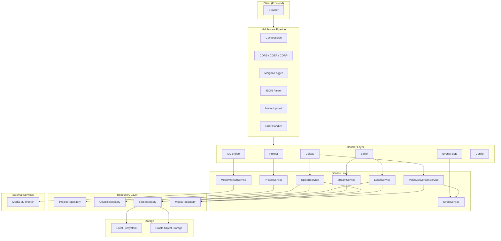
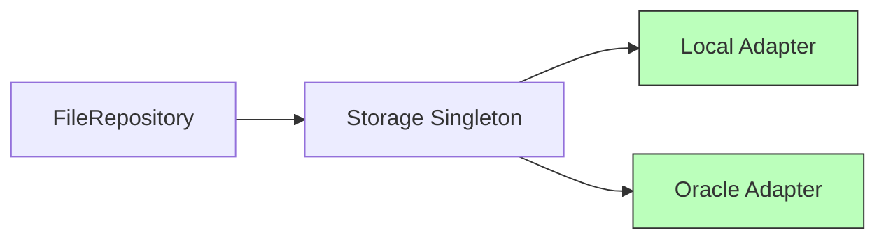
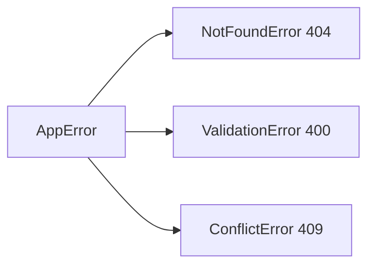
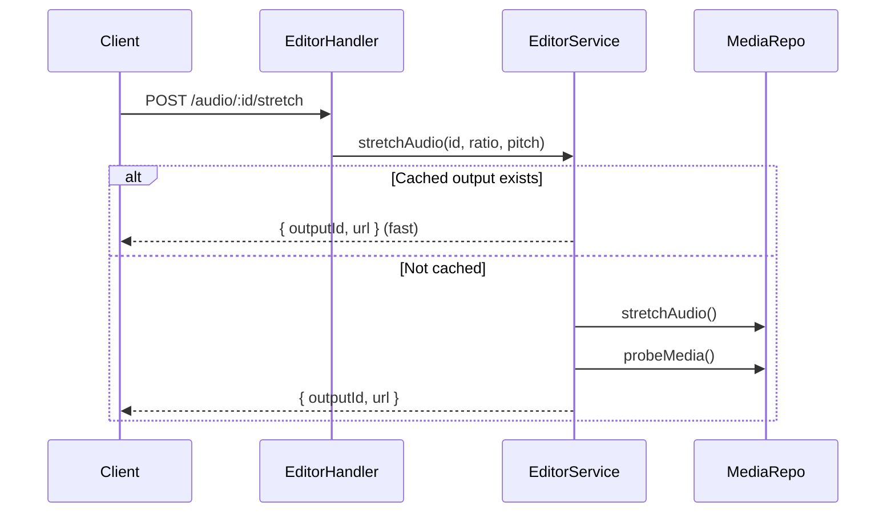
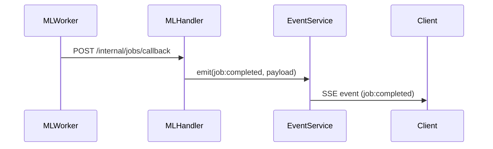

# Studio API Architecture

## Overview

Express.js backend API for a video/audio editor, following a **3-layer architecture** (Handlers → Services → Repositories) with pluggable storage adapters and real-time event delivery via Server-Sent Events.

---

## High-Level Architecture



---

## Middleware Pipeline

Requests pass through middleware in order:

1. **Compression** — gzip responses (disabled for `/events` SSE endpoints)
2. **CORS** — `Cross-Origin-Opener-Policy: same-origin`, `Cross-Origin-Resource-Policy: cross-origin`. COEP header skipped for SSE endpoints to avoid breaking cross-origin EventSource.
3. **Morgan** — HTTP request logging
4. **JSON Parser** — `express.json()` for request bodies
5. **Multer** — Multipart file upload (only on upload routes). Validates MIME types for video/audio. Falls back to extension validation for `application/octet-stream` (chunked uploads).
6. **Error Handler** — Catches all errors, returns structured JSON. Distinguishes `AppError` (operational) from unexpected errors.

---

## Handler Layer

Handlers are thin controllers that extract request parameters, delegate to services, and format responses. Errors are passed to `next(err)` for the error handler middleware.

| Handler | Responsibility |
| ------- | -------------- |
| **Project** | Workspace CRUD |
| **Upload** | Chunked video/audio upload, video conversion trigger, audio format retrieval |
| **Editor** | Project state load/save, audio stretching, thumbnails, video streaming, exports |
| **Events** | SSE subscription, 30s heartbeat, workspace-scoped event delivery |
| **ML** | Bridge to media-ml-worker for transcription and stem separation, stem ZIP download |
| **Config** | Application configuration endpoint |

---

## Service Layer

Services contain business logic and orchestrate repository calls. Each service is created via a factory function for testability.

### UploadService

Manages chunked file uploads using the flow.js protocol:

1. Validates flow parameters (chunkNumber, totalChunks, identifier)
2. Saves individual chunks via ChunkRepository
3. When all chunks arrive, assembles them into a single file
4. Extracts metadata via MediaRepository probe
5. Cleans up temporary chunks

Uses a `processingUploads` Map for atomic race-condition prevention during audio assembly.

### EditorService

Manages project state and audio operations:

- **Load/save** project state (JSON)
- **Audio stretching** with deterministic cache keys: `{basename}-s{ratio}-p{pitch}-t{start}-d{duration}`. Returns cached output if it exists (fast path).
- **Timeline management** via TrackListManager (reads/writes `trackList.json`)
- **Export** assembles final video with embedded audio tracks

### VideoConversionService

FFmpeg-based video processing:

- **Conversion**: H.264 + faststart, audio track removed. Supports CPU (`libx264`) and NVIDIA GPU (`h264_nvenc`).
- **Thumbnail generation**: Multi-scale tile sprites (8 scales, 10x10 grid, 80px height). Priority scale completes first. Each scale gets a `manifest.json` with fps, interval, and tile metadata.
- **Small video**: 360p preview for offline mode.

### StreamService

Returns file streams with metadata for HTTP responses. Supports range requests (HTTP 206) for video seeking. Handles on-the-fly audio format conversion via FFmpeg.

### EventService

Workspace-scoped SSE pub/sub:

- Maintains `Map<uuid, Set<response>>` for active connections
- Broadcasts events with schema: `{ type, payload, timestamp }`
- Caches last thumbnail status for late-joining clients
- Emits: `connected`, `thumbnails`, `job:completed`

### MediaWorkerService

HTTP client to the Python ML worker (FastAPI on port 8001):

- Job submission for transcription and stem separation
- Status polling
- Handles host-to-container path conversion for Docker environments

---

## Repository Layer

Repositories handle data access and persistence.

| Repository | Responsibility |
| ---------- | -------------- |
| **ProjectRepository** | Project CRUD via `projects.json`. Creates project directory structure. Reads workspace metadata (`uuid`, `title`, `isVideoLoaded`) while ignoring obsolete fields in existing registries. |
| **ChunkRepository** | Temporary chunk storage in `.tmp_chunks/`. Saves, validates, and assembles chunks sequentially. Uses lazy `init()` for async directory creation. |
| **FileRepository** | Abstraction over Storage adapters. Provides `readJson`, `writeJson`, `createReadStream`, `createWriteStream`, `exists`, `ensureDir`. All operations are async. |
| **MediaRepository** | Facade composing four specialized sub-repositories (see below). |

### MediaRepository Decomposition

MediaRepository is a facade that delegates to focused sub-modules, each injected via the factory pattern:

```text
MediaRepository (facade)
  ├── ProbeRepository      — ffprobe: media metadata, duration, frame extraction
  ├── ThumbnailRepository  — Multi-scale tile sprite generation (8 scales, 10x10 grid)
  ├── ExportRepository     — Final video/audio export with FFmpeg
  └── AudioProcessingRepository — Time-stretch (rubberband), format conversion
```

The facade exposes a flat API (`probeMedia`, `generateThumbs`, `stretchAudio`, `exportVideo`, etc.) so consumers don't need to know about the decomposition. Sub-repositories share `fileRepo` and `execFile` dependencies via a common `sharedDeps` object.

---

## Storage Adapter Pattern



**Common interface (all async except `createWriteStream`):** `ensureDir`, `exists`, `read`, `write`, `remove`, `removeDir`, `readJson`, `writeJson`, `list`, `stat`, `createReadStream`, `createWriteStream`, `copy`, `getUrl`

Adapter selection is driven by `STORAGE_PROVIDER` env var, resolved once at startup. The `local` adapter (filesystem) is the default and fully tested. The `oracle` adapter (OCI Object Storage) implements the full interface.

---

## Error Handling



All operational errors extend `AppError` with `statusCode`, `code`, and `isOperational` flag. The error handler middleware returns structured responses:

```json
{
  "error": {
    "code": "NOT_FOUND",
    "message": "Resource not found"
  }
}
```

Multer errors (file size, invalid type) are caught and converted to user-friendly messages.

---

## Key Data Flows

### Video Upload and Conversion

```mermaid
sequenceDiagram
    participant Client
    participant UploadHandler
    participant UploadService
    participant ChunkRepo
    participant MediaRepo
    participant VideoConvService
    participant EventService

    Client->>UploadHandler: POST /video/file (chunk N)
    UploadHandler->>UploadService: handleVideoChunk()
    UploadService->>ChunkRepo: saveChunk(N)

    alt All chunks received
        UploadService->>ChunkRepo: assembleChunks()
        UploadService->>MediaRepo: probeMedia()
        UploadService-->>Client: { status: complete }
    else More chunks expected
        UploadService-->>Client: { status: uploading }
    end

    Client->>UploadHandler: POST /video/convert
    UploadHandler->>VideoConvService: convertVideo()
    UploadHandler-->>Client: 202 Accepted

    VideoConvService->>MediaRepo: generateThumbsTiles()
    VideoConvService->>EventService: emit(thumbnails, progress)
    VideoConvService->>MediaRepo: convertVideo()
    VideoConvService->>EventService: emit(thumbnails, ready)
```



### Audio Stretch (with caching)



### ML Job Callback



---

## Design Patterns

1. **Factory Creators** — Services and repositories are created via `*Creator(deps = {})` factory functions returning plain objects. Production code uses defaults; tests inject mocks. See [ADR 002](docs/adr/002-factory-functions-di.md).
2. **Facade Composition** — MediaRepository composes four sub-repositories (probe, thumbnails, export, audio processing) behind a flat API surface.
3. **Async-First I/O** — All filesystem operations use `fs.promises.*`. No `*Sync` calls in application code (except config bootstrap and `createWriteStream`). See [ADR 004](docs/adr/004-async-first-io.md).
4. **Atomic Operations** — `processingUploads` Map prevents race conditions during concurrent chunk assembly for the same audio file.
5. **Deterministic Caching** — Stretched audio files are cached with a key derived from input parameters, avoiding redundant processing.
6. **Stream Piping** — Chunk assembly pipes sequential read streams into a single write stream for memory-efficient large file handling.
7. **Background Processing** — Video conversion and thumbnail generation return immediately (HTTP 200). Progress and completion are communicated via SSE events.
8. **Graceful Shutdown** — SIGTERM/SIGINT handlers close the HTTP server and clean up resources.
9. **Temp Cleanup** — Background interval removes stale upload chunks based on configurable TTL (default 30 minutes).
