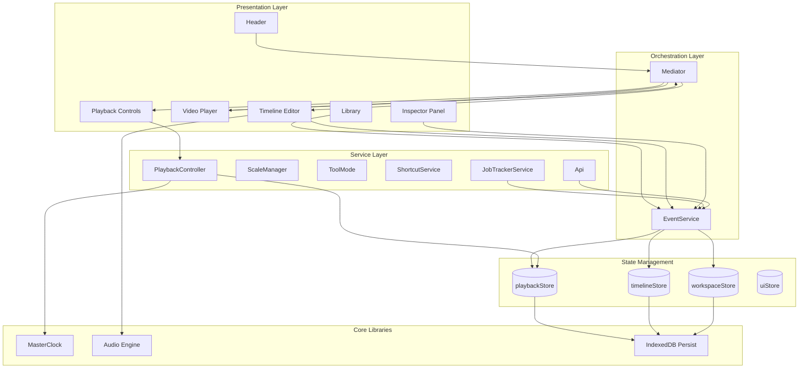
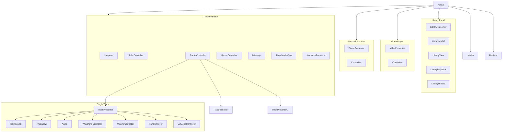
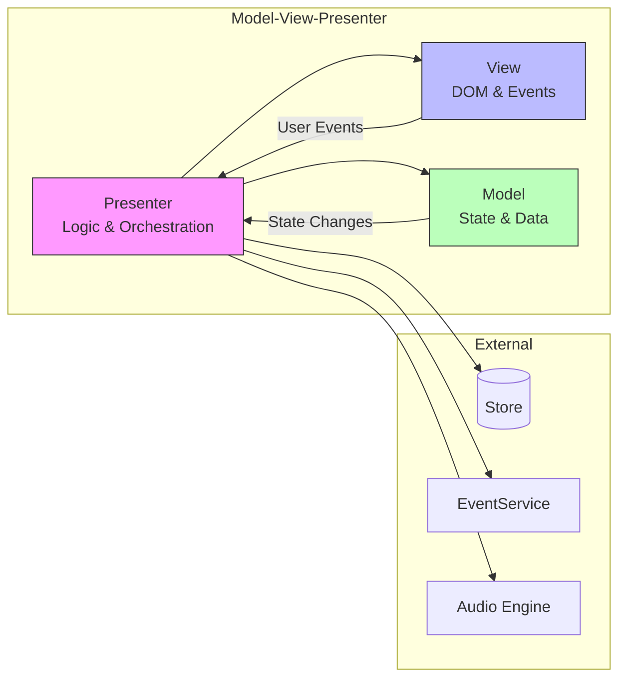
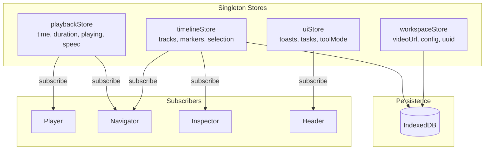
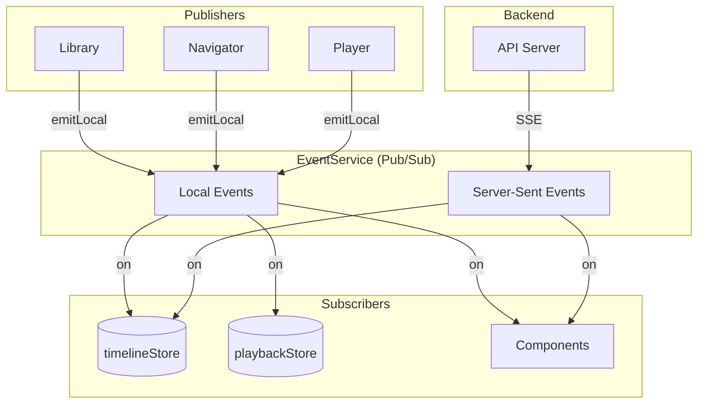
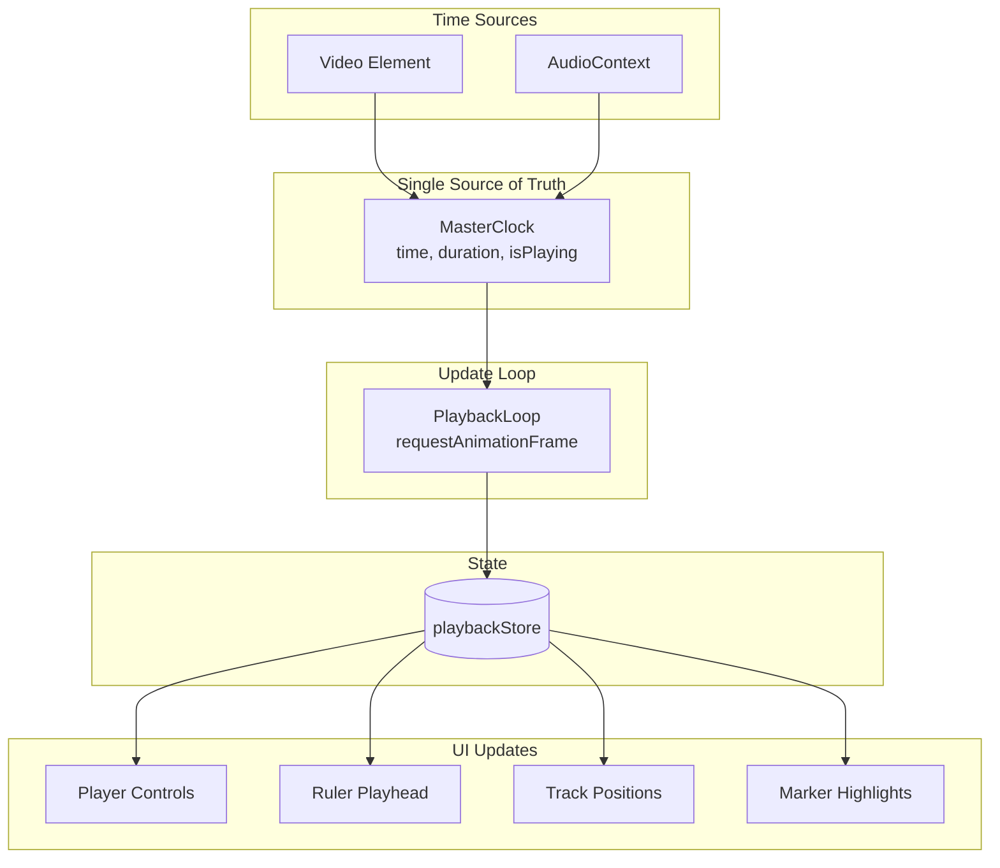
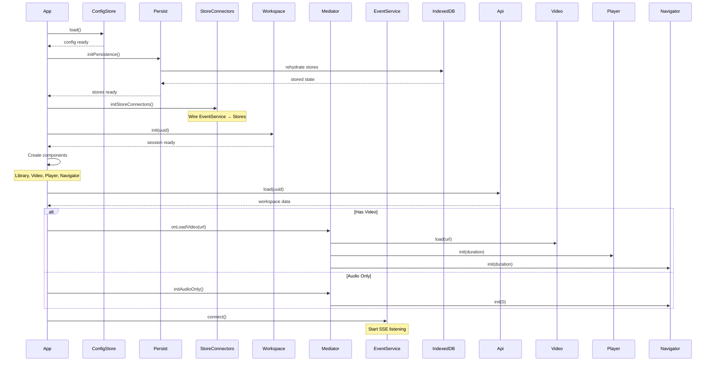
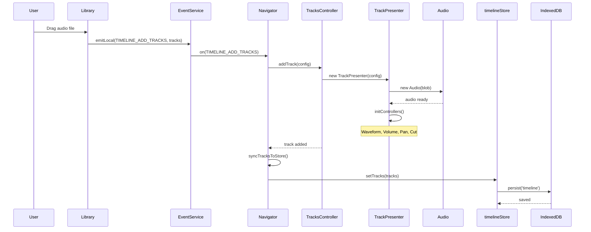
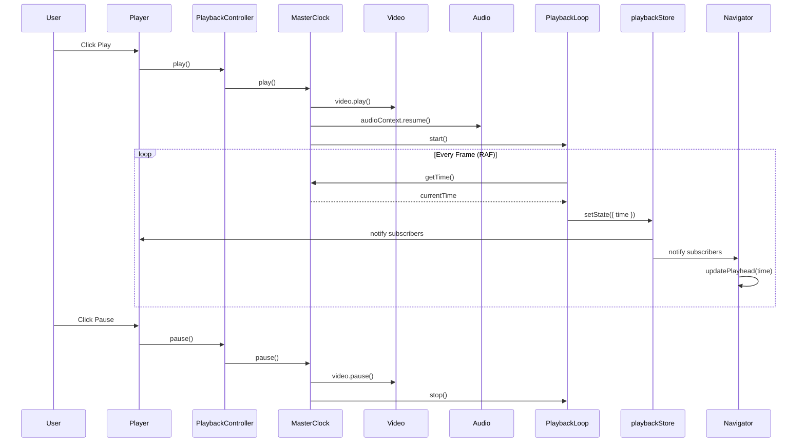
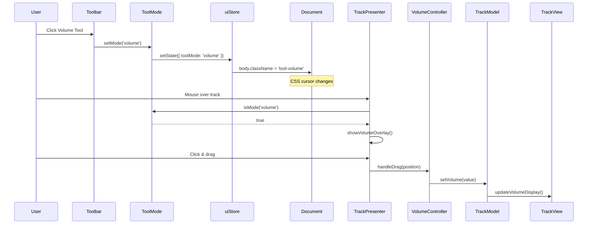

# Studio Frontend Architecture

## Overview

Studio is a web-based DAW (Digital Audio Workstation) built with vanilla JavaScript following established architectural patterns: **MVP** (Model-View-Presenter), **Flux-like stores**, and **Event-driven communication**.

---

## High-Level Architecture



---

## Component Hierarchy



---

## MVP Pattern



**Responsibilities:**

- **Presenter**: orchestration, business logic, service calls
- **View**: DOM rendering, event binding, lifecycle (mount/destroy)
- **Model**: local component state, actions, notifications

---

## State Management (Flux-like Stores)



### Store API

```javascript
// Pattern
const store = createStore(initialState, {
  actions: {
    actionName(state, payload) {
      return {
        /* partial update */
      };
    }
  }
});

// Usage
store.getState(); // Read
store.setState(updates); // Write
store.actions.method(arg); // Action
store.subscribe(callback); // Watch
```

---

## Event Communication



### Event Categories

| Category | Events | Purpose |
| -------- | ------ | ------- |
| Playback | `PLAYBACK_PLAY`, `PLAYBACK_PAUSE`, `PLAYBACK_MOVE` | Playback control |
| Timeline | `TIMELINE_ADD_TRACKS`, `MARKERS_CHANGED` | Timeline editing |
| Video | `VIDEO_LOADED`, `VIDEO_DELETED` | Video management |
| System | `CONNECTION`, `THUMBNAILS`, `JOB_COMPLETED` | Backend events |

---

## Playback Time Synchronization



---

## Sequence Diagrams

### Application Initialization



### Track Addition Flow



### Playback Control Flow



### Tool Mode Interaction



---

## Design Principles

1. **Single Source of Truth**: `MasterClock` for time, stores for state
2. **Immutable Updates**: `setState()` creates new objects, never mutates
3. **Presenter as Orchestrator**: logic lives in presenters, not in views
4. **Event-Driven**: components decoupled via EventService
5. **Offline-First**: IndexedDB for persistence, offline fallback in Api
6. **Tool-First Pattern**: tools operate on any track without prior selection
7. **Canvas for Performance**: waveforms rendered on Canvas, not SVG

For the rationale behind these choices, see the [Architecture Decision Records](docs/adr/).

---

## Styles

```
src/styles/
├── index.css        entry point: the import order IS the cascade order
├── tokens.css       design tokens (the only file allowed to hold raw colors)
├── layout.css       html/body, app shell, focus rings
├── utilities.css    utility classes, responsive tweaks
└── components/      shared controls: button, range, toggles
src/components/**/   each component keeps its stylesheet next to its JS
```

**Tokens have three layers:**

| Layer | Examples | Used by |
| --- | --- | --- |
| Primitives | `--gray-750`, `--iris-500`, `--space-3` | `tokens.css` only |
| Semantic | `--surface-panel`, `--text-subtle`, `--accent-default`, `--fn-volume`, `--playhead` | all components |
| Legacy | `--accent`, `--panel-bg`, `--bs-info` | old rules; mapped onto semantic tokens, removed as components migrate |

**Rules:**

1. **One color, one meaning.** `--accent-*` marks selection, focus, the active mode and the primary action. `--fn-volume`, `--fn-pan`, `--fn-cut` appear only inside their function. `--playhead` is reserved for time. Red (`--danger-*`) shows on hover or confirmation, never at rest.
2. **Three kinds of control**, each with its own look: modes (segmented pill, accent when active), actions (neutral buttons), options (switches or soft-accent toggles).
3. **Selection never changes layout.** Tools for the selected clip dock in `.timeline-dock`.
4. **A rule lives in exactly one file.** No override layers appended at the end.
5. **Debt only goes down.** `npm run lint:css` counts raw colors, `!important` and `backdrop-filter` outside `tokens.css` and fails above `css-budget.json`. It runs in the pre-commit hook and in CI. After a cleanup, lock the gain with `npm run lint:css -- --update`.

---

## Type Safety

The project uses `// @ts-check` + JSDoc for gradual type checking.

```javascript
// @ts-check

/**
 * @typedef {import('@/types').Track} Track
 */

/**
 * @param {Track} track
 * @returns {void}
 */
function processTrack(track) {
  // ...
}
```

**Type-checked files:**

- `store/createStore.js`
- `store/playbackStore.js`
- `lib/MasterClock.js`
- `lib/audio/nodes/Volume.js`

**Run type check:** `npm run typecheck`
